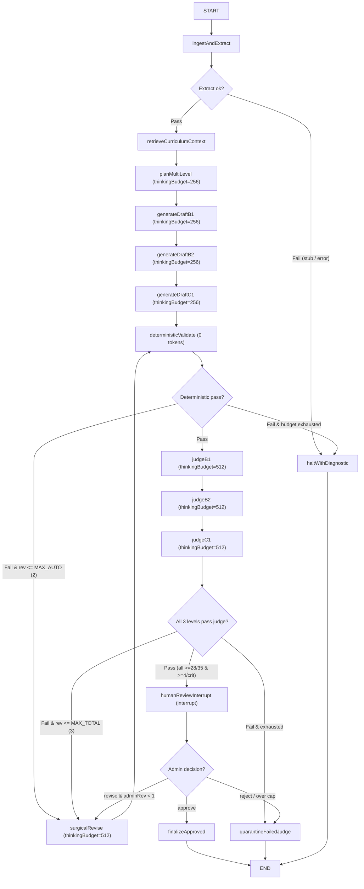
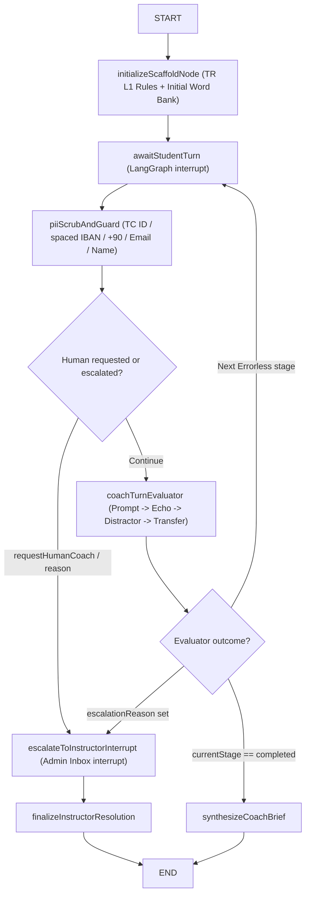
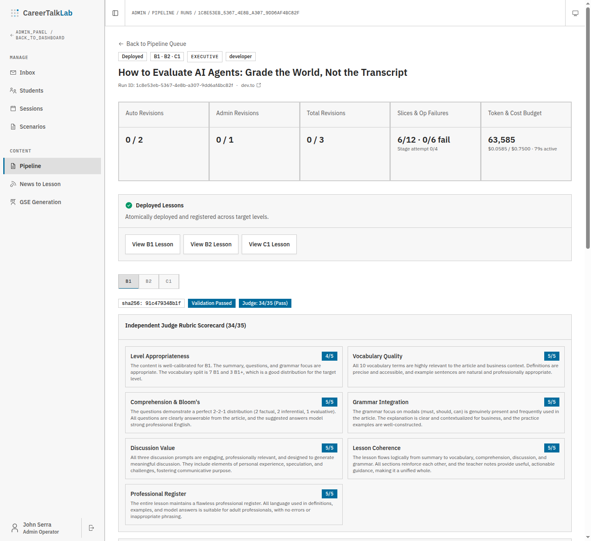
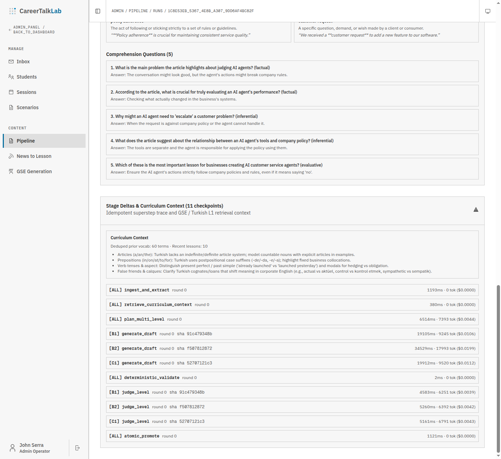

# Production LangGraph Architecture on Serverless Vercel & Hosted Supabase: Multi-Agent Newsjacking, Errorless Coaching & Empirical Telemetry

**Case Study — CareerTalkLab Agentic Content & Coaching Architecture**  
**Stack:** Next.js 16 (App Router on Vercel Pro, `60s` serverless function timeout ceiling, `1`-minute cron reaper) · TypeScript · `@langchain/langgraph` (`^1.7.4`) · Gemini 2.5 Flash (`@google/genai`) · Supabase PostgreSQL (`SECURITY DEFINER` RPCs over PostgREST) · Vitest + PGlite + Postgres 16 Multi-Connection CI

> **Visibility Boundary:** CareerTalkLab ([careertalklab.com](https://www.careertalklab.com)) is live in production, while its commercial repository, internal prompt templates, and proprietary curriculum assets remain private. This public engineering case study documents the sanitized orchestration architecture, state-machine topologies, safety invariants, human-governance UI, and empirical `N = 20` evaluation results alongside the [Digital Twin engineering case study](digital-twin-case-study.md).

---

## 1. Executive Summary & Empirical Headline Outcomes

CareerTalkLab uses selective, boundary-enforced stateful agent orchestration rather than blanket LLM loops. Across four core learning and content workflows, LangGraph (`StateGraph` backed by a custom PostgREST checkpoint saver) is reserved strictly for workflows with cyclic critique-and-repair loops, multi-turn pedagogical scaffolding, or durable human-in-the-loop interrupts — while attainment math, credit ledgers, and foundational drills execute in deterministic SQL and TypeScript.

A held-out **20-article live evaluation** (`gemini-2.5-flash`, `standard` tier, 3 CEFR levels per article = **60 target CEFR drafts per evaluation pass**) revealed two high-impact production defects in the initial baseline pass (`$1.02`, `5/20` accepted runs, `11/20` aborted on per-call timeouts) and validated targeted fixes in a full post-remediation pass (`$0.89`, **`17/20` accepted runs**, **`0/20` operational timeouts**):

| Metric (20 Articles / 60 Drafts) | Pre-Remediation Pass | Post-Remediation Pass | Delta |
| --- | --- | --- | --- |
| Held-out articles / target CEFR drafts | `20` / `60` | `20` / `60` | — |
| End-to-end run acceptance (`ready_for_review`) | `5 / 20` (`25.0%`) | **`17 / 20` (`85.0%`)** | **`+60.0 pts`** (`+12` runs) |
| Operational timeout failures (`failed_operational`) | `11 / 20` (`55.0%`) | **`0 / 20` (`0.0%`)** | **`-11` runs** |
| Deterministic compliance after surgical repair\* | `8 / 20` runs (`27 / 60` drafts = `45.0%`) | **`19 / 20` runs (`59 / 60` drafts = `98.33%`)** | **`+53.33 pts`** (`+32` drafts) |
| Initial LLM Judge pass rate (evaluated / total 60) | `18 / 30` (`60.0%` eval, `30.0%` total) | **`52 / 60` (`86.67%`)** | **`+26.67 pts`** evaluated |
| Final LLM Judge pass rate\* (evaluated / total 60) | `23 / 30` (`76.67%` eval, `38.33%` total) | **`57 / 60` (`95.0%`)** | **`+18.33 pts`** evaluated |
| Final Judge mean score (out of `35`) | `33.20 / 35` (`30` evaluated) | **`33.13 / 35` (`60` evaluated)** | Quality held at `2x` scale |
| Reasoning (`thoughtsTokens`) volume | `214,936` (`58.3%` of gen+thought) | **`60,327` (`20.8%` of gen+thought)** | **`-71.9%`** |
| Total pass cost (20 runs, 172 vs 114 calls) | `$1.02` (`$0.05` mean budgeted) | **`$0.89` (`$0.04` mean/run)** | **`-12.9%` despite `1.51x` more calls** |
| Per-run latency (`p50` / `p95`, wall-clock across slices) | `161,531ms` / `255,120ms` | **`68,182ms` / `82,240ms`** | **`-57.8%` p50 / `-67.8%` p95** |
| Total wall-clock pass duration | `1,955,304ms` (`32.6 min`, concurrency `2`) | **`501,470ms` (`8.36 min`, concurrency `3`)** | **`-74.4%` (`3.9x` faster)** |

\* *Gate note:* Every judged draft passed deterministic validation in the round it was judged. Judged draft totals (`30` in baseline, `60` post-remediation) exceed final post-repair deterministic compliance (`27/60` and `59/60`) because a subsequent surgical repair triggered by a failing judge verdict loops back through the deterministic gate (`REV -> DET`) and can still fail re-validation once `MAX_AUTO_REVISIONS = 2` is exhausted (`bench_hosp_06` C1 expanded to `13` vocabulary terms post-remediation; `3` baseline drafts hit shallow-spread field wipes).

---

## 2. Architectural Decision Record: Where LangGraph Earns Its Keep vs. Deterministic SQL/TS

Not every LLM or curriculum workflow benefits from a stateful agent graph. Unnecessary graphs inflate tail latency, complicate idempotency, and obscure audit trails. CareerTalkLab enforces a strict boundary across four product surfaces:

| Surface | Domain & Goal | Runtime Architecture | Why This Boundary |
| --- | --- | --- | --- |
| **Surface A — Newsjacking Lesson Pipeline** | Convert industry news into 3 CEFR-differentiated lessons (`B1`, `B2`, `C1`) across technical and marketing tracks. | **LangGraph `StateGraph`** (11 nodes, bounded cyclic self-repair + `humanReviewInterrupt`) backed by checkpointing & lease RPCs. | Requires parallelizable per-level drafting, deterministic gatekeeping before expensive semantic judging, selective per-section JSON repair, and resumable admin sign-off. |
| **Surface B — Attainment, Credits & Scenario Rehearsal** | Track Level 1/Level 2 mastery (`user_unit_attainment`), referral rewards, rate limits, and deterministic role-play rehearsal turns. | **Pure PostgreSQL `SECURITY DEFINER` RPCs + Deterministic TypeScript** for attainment/credits; isolated `ScenarioRehearsalGraph` for extracurricular L2 → L3 practice. | Mastery attainment, prerequisite unlocking, and credit/referral mutations demand zero-variance ACID invariants and `FOR UPDATE` row locks — never probabilistic graph routing. |
| **Surface C — Proactive Errorless Coaching** | Guide Turkish learners through multi-turn writing refinement (`Prompt -> Echo -> Distractor -> Transfer`) with L1 interference scaffolding and optional human escalation. | **LangGraph `StateGraph`** (7 nodes, PII scrub gate, multi-turn `awaitStudentTurn` interrupt, instructor escalation interrupt). | Naturally multi-turn with conditional interruption: pauses cleanly after every student message (`awaitStudentTurn`), tracks retry streaks (`MAX_COACHING_CONSECUTIVE_RETRIES = 3`), and suspends into `/admin/inbox` (`escalateToInstructorInterrupt`) when human intervention is requested or retries cap out. |
| **Surface D — Foundational A1/A2 Drills** | High-volume free GSE-aligned onboarding lessons using `Prompt -> Echo -> Distractor -> Transfer`. | **Deterministic client/RPC progression**. | Sub-`100ms` UX, `$0` marginal inference cost, and fixed pedagogical sequencing require zero graph state overhead. |

> **Architectural Invariant (Surface B Isolation):** `ProactiveCoachingGraph` (Surface C) writes strictly to coaching session/turn tables, the student's own `submissions` record on completion/resolution, and isolated `langgraph.*` checkpoint tables. It has zero write paths into `user_unit_attainment` or referral/credit reward RPCs (verified offline in Safety Scenario 7).

---

## 3. State Machine Topologies

### 3.1 Surface A: `LessonPipelineGraph` (11 Nodes, Cyclic Gate & Human Interrupt)

The newsjacking pipeline runs untrusted article ingestion once, plans across target levels, generates CEFR-adapted drafts, gates every level through zero-cost deterministic structural validation, and evaluates passing drafts with a 7-criterion LLM judge:

Key cost-control optimizations in the graph:
1. **Hash-Gated Selective Re-Judging:** The judge node compares each level's `draftSha256` against `lastEvaluatedHash` in prior `JudgeVerdict`s; untouched levels skip redundant judge LLM calls across surgical revision rounds.
2. **Deterministic Gate First (and After Every Repair):** Structural rules (vocabulary count `8..12`, 5 comprehension questions following `2-2-1` Bloom's taxonomy, 3 discussion prompts, `grammar_focus` shape, and POS/article-anchoring invariants) are checked in `0ms` at `$0.00` before spending ~`6k` tokens per level on LLM judging, and every surgical repair re-enters `deterministicValidate` before any re-judge runs.

### 3.2 Surface C: `ProactiveCoachingGraph` (7 Nodes, Multi-Turn & Escalation Interrupts)

`ProactiveCoachingGraph` turns student writing drafts into a supportive, ungraded coaching conversation rooted in Errorless Teaching:

---

## 4. Serverless Postgres Checkpointing, Lease Contention & Budget Governance

Vercel Serverless Functions enforce a `60s` execution ceiling (`MAX_DURATION_MS = 60_000`) per slice, and Hosted Supabase provides PostgREST HTTPS transport rather than arbitrary persistent connection pools in serverless handlers. To make multi-step LangGraph checkpointing safe under timeouts, cron recovery, and double-click races:

1. **Custom PostgREST Checkpointer (`SupabaseRpcCheckpointSaver`):**
   Implements LangGraph's `BaseCheckpointSaver` over five `service_role`-only `SECURITY DEFINER` RPCs backed by isolated `langgraph.checkpoints`, `langgraph.checkpoint_writes`, and `langgraph.checkpoint_blobs` tables. Write ordering preserves LangGraph's `(task_path, task_id, idx)` tuple sorting (`__error__`, `__scheduled__`, `__interrupt__`, `__resume__`).
2. **Cooperative Slice & Admission Budgets:**
   - `MAX_DURATION_MS = 60_000`: Total wall-clock budget per serverless slice (cumulative multi-slice article runs can span >`60s` wall-clock safely across cooperative handoffs).
   - `HARD_WORK_CUTOFF_MS = 52_000`: Slice yields cleanly `8,000ms` before the serverless ceiling so pending checkpoints flush safely.
   - `MIN_NODE_START_BUDGET_MS = 18_000`: Nodes refuse to initiate new LLM calls if insufficient headroom remains, yielding cleanly for client `/advance` or the `1`-minute `/api/cron/pipeline-reaper` worker to resume.
   - `PER_CALL_CAP_MS = 25_000`: Every `@google/genai` call binds an `AbortSignal` bounded by `min(25_000, remainingBudget)` so no hung upstream socket stalls the slice.
   - `MAX_RUN_SLICES = 12`, `MAX_RUN_TOKENS = 250_000`, `MAX_RUN_COST_USD = 0.75`: Per-run hard circuit breakers checked before LLM invocation.
3. **Postgres `FOR UPDATE` Lease Contention & Idempotent Turn Claims:**
   - **Surface A:** `claim_pipeline_run_lease` uses row-level locking (`FOR UPDATE SKIP LOCKED` and lease expiry validation) so concurrent workers cannot double-advance the same run, while `begin_pipeline_human_resume` and `promote_pipeline_bundle` enforce `409 DRAFT_HASH_MISMATCH` if an admin attempts to approve stale SHA-256 `expectedApprovedHashes`.
   - **Surface C:** `claim_coaching_session_turn` locks `coaching_sessions` (`FOR UPDATE`), deduplicates via `(session_id, idempotency_key)`, enforces turn character bounds (`1,500` chars), and ensures single-writer execution under concurrent requests (verified against real Postgres 16 in multi-connection contention CI). Database triggers and writeback RPCs enforce `submissions.student_id = coaching_sessions.user_id` and `submissions.type = 'writing'` prior to reserving credits so cross-user or non-writing submission links fail cleanly.
4. **Server-Authoritative Metadata Overwrite Protection:**
   Both article extraction (boxed inside `<untrusted_source_article>` delimiters with a system prompt injection guard) and draft generation treat model output as untrusted for governance fields: `source_url`, `cefr_level`, and `target_track` are overwritten server-side after JSON parsing so prompt injections cannot alter publication routing.

---

## 5. Human Governance Interface (Observed Production Run)

Reviewers govern runs in `/admin/pipeline/runs/[runId]` without inspecting server logs. Below is a live zero-revision promoted production run (`How to Evaluate AI Agents: Grade the World, Not the Transcript`, `B1 · B2 · C1`, `6/12` slices, `63,585` tokens, `$0.06 / $0.75`, `79s` active across slices) showing hash-pinned deployment links and the 7-criterion Independent Judge Rubric Scorecard (`34/35` B1, `33/35` B2, `35/35` C1):

Expanding the **Stage Deltas & Curriculum Context** drawer exposes the deduplicated prior vocabulary window (`60` terms across `10` recent lessons), Turkish L1 scaffolding warnings, and all `11` chronological superstep checkpoints on a clean zero-revision path (from `ingest_and_extract` through `atomic_promote`); runs that enter surgical repair append additional `surgical_revise`, re-validation, and selective re-judge deltas (such as the `15`-delta trace in §6.6):

---

## 6. Empirical Case Study: Before vs. After 20-Article `gemini-2.5-flash` Benchmark

Running inside an embedded PGlite instance initialized with the full production migration chain, `20` held-out real-world articles (`8` developer, `6` marketing, and `6` hospitality — CareerTalkLab's third legacy industry track, retained in the corpus to test domain generalization outside software and marketing jargon; `targetTrack = "executive"`, `minSourceLength = 498` chars) were evaluated under a strict `$1.50` hard cost cap.

### 6.1 What the `$1.02` Baseline Pass Uncovered (Root Causes)

Running the initial pipeline untouched against live `gemini-2.5-flash` exposed three defects invisible under mocked fast-returning tests:

1. **Unbudgeted Thinking Saturation (`11 / 20` `failed_operational`):**
   Without an explicit `thinkingConfig.thinkingBudget` cap, `gemini-2.5-flash` spent **`214,936 thoughtsTokens`** across `114` calls — **`58.3%` of all generated + thinking tokens** (`153,684` output tokens). Long reasoning tails frequently exceeded `PER_CALL_CAP_MS = 25_000ms`, triggering `AbortSignal` operational timeouts mid-draft or mid-judge.
2. **Shallow Patch Spread Corruption (`2 / 20` `failed` — `bench_hosp_01`, `bench_hosp_06`):**
   `surgicalRevise` previously merged partial LLM patches via shallow object spread (`{ ...priorDraft, ...levelPatch }`). When a surgical patch repaired only `grammar_focus.examples`, the shallow spread replaced the entire nested `grammar_focus` object, wiping `title` and `explanation` and failing deterministic validation.
3. **Random-UUID Stage Ordering Bug in Telemetry Script:**
   The benchmark collector originally ordered `pipeline_run_stage_deltas` by `ORDER BY id ASC`. Because `id` is a random UUIDv4 rather than monotonic time, multi-round initial vs. final judge snapshots were scrambled on multi-revision runs.

### 6.2 Targeted Remediations Applied

1. **Explicit Stage-Scoped `thinkingBudget`:**
   - `planMultiLevel`: `thinkingBudget = 256`
   - `generateDraftLevel`: `thinkingBudget = 256`
   - `judgeLevel`: `thinkingBudget = 512`
   - `surgicalRevise`: `thinkingBudget = 512`
2. **Recursive `mergeSurgicalDraftPatch(priorDraft, patch)`:**
   Deep-merges nested plain objects (`grammar_focus`, `live_session_cheat_sheet`, `speaking_class_guide`), ignores `null` / `undefined` / whitespace-only strings, and rejects accidental empty `[]` array wipes so untouched sibling fields remain intact.
3. **Chronological Delta Sorting & Archived Baseline Comparison:**
   Sorted stage deltas by `(created_at, revision_round, stage_rank)` and preserved the pre-fix `$1.02` baseline snapshot for paired delta reporting.

### 6.3 Post-Remediation Performance Across Segments (`N = 20`, Total Pass Cost `$0.89`)

| Segment | Articles | Pass-0 Det Runs | Final Accepted (`ready_for_review`) | Final Judge Mean Score | Mean Wall-Clock Latency (Across Slices) | Mean Cost / Run |
| --- | :---: | :---: | :---: | :---: | :---: | :---: |
| **Developer** | `8` | `1 / 8` | **`6 / 8` (`75.0%`)** | `32.92 / 35` | `73,597ms` | `$0.046` |
| **Marketing** | `6` | `1 / 6` | **`6 / 6` (`100.0%`)** | `33.44 / 35` | `68,530ms` | `$0.043` |
| **Hospitality** | `6` | `0 / 6` | **`5 / 6` (`83.3%`)** | `33.11 / 35` | `69,109ms` | `$0.044` |
| **All Segments** | **`20`** | `2 / 20` (`32 / 60` drafts) | **`17 / 20` (`85.0%`)** | **`33.13 / 35` (`57 / 60` pass)** | **`70,730ms`** | **`$0.044`** |

Key self-healing impact of the cyclic graph: while only `2 / 20` runs (`10.0%`) passed deterministic validation cleanly on Pass 0 (`32 / 60` level drafts), **surgical self-repair pushed deterministic compliance to `19 / 20` runs (`59 / 60` drafts = `98.33%`, `+27` drafts recovered)** and lifted **15 blocked runs** into admin-ready `ready_for_review` (`17 / 20` total; `2` clean first-pass + `15` recovered via auto-revision across `25` revision rounds in `18` runs).

### 6.4 LLM Judge Rubric Calibration (`60 / 60` Evaluated Drafts Out of `5.0`)

| Rubric Criterion | Initial Judge Mean | Final Judge Mean | Post-Revision Delta |
| --- | :---: | :---: | :---: |
| `level_appropriateness` | `4.15` | `4.20` | `+0.05` |
| `vocabulary_quality` | `4.75` | `4.80` | `+0.05` |
| `comprehension_blooms` | `4.67` | `4.77` | `+0.10` |
| `grammar_integration` | `4.52` | `4.57` | `+0.05` |
| `discussion_value` | `4.90` | `4.90` | `0.00` |
| `lesson_coherence` | `4.87` | `4.93` | `+0.06` |
| `professional_register` | `4.97` | `4.97` | `0.00` |
| **Total Score (out of `35`)** | **`32.82`** (`52 / 60` pass) | **`33.13`** (`57 / 60` pass) | **`+0.31`** (`+5` drafts) |

### 6.5 Diagnostic Inspection of the 3 Non-Accepted Runs (Correct Gate Behavior)

Rather than silently publishing degraded content, all 3 non-accepted runs halted cleanly at `MAX_AUTO_REVISIONS = 2` with actionable diagnostics:
- **`bench_dev_01` (`failed_judge`, `martinfowler.com`):** Passed deterministic checks (`3/3`), failed B1 `grammar_integration = 3` because one grammar example lifted verbatim DDL syntax (`ACCESS EXCLUSIVE lock`) above B1 complexity and another omitted the taught `"when"` clause.
- **`bench_dev_03` (`failed_judge`, `web.dev`):** Passed deterministic checks (`3/3`), failed B1 `level_appropriateness = 3` because vocabulary leaned heavily into B1+/B2 technical compounds (`data-backed`, `bottleneck`, `client-side`, `cross-functional`) exceeding the 40% B1+ ceiling.
- **`bench_hosp_06` (`failed`, `sustainablehospitalityalliance.org`):** Passed Round 1 deterministic checks (`3/3`) and reached Round 1 judging (`B1=31`, `B2=34`, `C1=29` fail), then Round 2 `auto_judge` surgical repair expanded `C1` vocabulary to `13` terms—failing Round 2 deterministic re-validation (`8..12` bound) cleanly at `MAX_AUTO_REVISIONS = 2`.

### 6.6 Chronological Redacted Execution Trace (`bench_dev_02`, `engineering.fb.com`)

`bench_dev_02` (`Cutting Tail Latency with Request Hedging and Adaptive Circuit Breakers`, `82,240ms` wall-clock across slices, `48,664` tokens, `$0.051`, **`15` stage deltas** across **`2` surgical repair rounds** prior to human promotion — compared against `11` deltas for a zero-revision promoted production run) demonstrates both repair loops in sequence:

1. **Ingest & Context (`13ms`, `$0.00`):** Extracted `882` chars from `engineering.fb.com`, queried curriculum deduplication context (`0` tokens).
2. **Plan & Draft Generation (`51,721ms` across 4 calls):**
   - `plan_multi_level` (`3,161ms`, `953` tok, `$0.001`)
   - `generate_draft` `B1` (`13,789ms`, `4,520` tok, hash `71c376039dcb`)
   - `generate_draft` `B2` (`18,110ms`, `4,933` tok, hash `a22efc0b1105`)
   - `generate_draft` `C1` (`16,661ms`, `5,180` tok, hash `1001a3c7443d`)
3. **Round 0 Deterministic Gate (`0ms`, `$0.00`) -> Fail (`B2`):** Flagged `B2` `discussion_prompts` count (`4` instead of required `3`).
4. **Round 1 Surgical Revise (`auto_validate`, `3,263ms`, `3,943` tok, `$0.003`):** Targeted only `B2` `discussion_prompts`; `B2` hash mutated `a22efc0b1105` -> `95dab1b2d7ca` while `B1` (`71c376039dcb`) and `C1` (`1001a3c7443d`) remained unchanged. Round 1 deterministic gate passed (`3/3`, `0` errors).
5. **Round 1 Parallel-Sequential LLM Judges (`16,027ms`):**
   - `B1` (`71c376039dcb`): `29/35` — failed (`level_appropriateness = 3`)
   - `B2` (`95dab1b2d7ca`): `34/35` — **PASS**
   - `C1` (`1001a3c7443d`): `35/35` — **PASS**
6. **Round 2 Surgical Revise (`auto_judge`, `6,112ms`, `4,361` tok, `$0.004`):** Repaired only `B1` `["article_summary", "vocabulary"]` to reach `11` vocabulary terms (`40%` B1+ ratio); `B1` hash updated `71c376039dcb` -> `db99fb7853a2`.
7. **Round 2 Re-Validation & Selective Judge (`4,680ms`):** Deterministic validate passed (`0ms`); **only `B1` (`db99fb7853a2`) was re-judged**, rising to **`32/35`** (`level_appropriateness = 4`, `passed = true`), skipping redundant re-judging of `B2` and `C1` before interrupting in `ready_for_review`.

---

## 7. Errorless Teaching Pedagogy & 7-Scenario Safety / Governance Matrix

### 7.1 Turkish L1 Interference Scaffolding

Because CareerTalkLab serves Turkish engineers, marketers, and business professionals, Surface C encodes empirically derived Turkish-to-English interference rules deterministically inside `initializeScaffoldNode`:
- Maps common Turkish-to-English transfer patterns—article omission, preposition errors carried over from Turkish postpositions, copula (*to be*) omission, and pronoun transfer—to concrete **stealth cues** (brief pre-writing prompts that model the target English pattern before the learner drafts, without red-pen error labels) and an initial Word Bank.
- Prompts never expose linguistics jargon (`"copula"`, `"definite article"`), never assign grades or percentages (`Errorless Teaching` Zero Pass/Fail rule), and normalize student input through `scrubPII` (`[EMAIL]`, `[ID]`, `[IBAN]`, `[PHONE]`, `[Student]`) before persistence or inference.

### 7.2 Offline Safety, Governance & Concurrency Matrix

All invariants are enforced continuously in automated tests (Vitest + PGlite and multi-connection Postgres 16 CI):

| Scenario | Verified Invariant | Verification Layer |
| --- | --- | --- |
| **Scenario 1** | Prompt injection payloads (`IGNORE ALL PREVIOUS INSTRUCTIONS...`) stay boxed inside `<untrusted_source_article>`, and server overrides `meta.source_url`, `meta.cefr_level`, `meta.target_track`. | Automated safety suite |
| **Scenario 1b** | `mergeSurgicalDraftPatch` deep-merges partial `grammar_focus` edits without letting `null`, empty strings, or `[]` wipe sibling fields, and verifies `thinkingBudget` caps on live graph calls. | Automated safety suite |
| **Scenario 2** | Short article stubs (`< 200` chars) halt deterministically inside `ingestAndExtractNode` with zero Gemini API calls or token spend. | Automated safety suite |
| **Scenario 3** | `scrubPII` & `pseudonymizeName` strip Turkish TC Kimlik IDs, spaced/contiguous `TR` IBANs, `+90` phones, `[EMAIL]` tokens, and student full names prior to storage/LLM prompt construction. | Automated safety suite |
| **Scenario 4** | Graph halts cleanly at bounded `MAX_AUTO_REVISIONS = 2` and rejects `admin_revise` beyond `MAX_ADMIN_REVISIONS = 1`. | Automated safety suite |
| **Scenario 5** | Concurrent workers face single-winner lease acquisition (`PipelineRunConflictError`), and stale human approvals fail with `409 DRAFT_HASH_MISMATCH`. | Automated safety suite + Postgres 16 CI |
| **Scenario 6** | Exceeding `MAX_RUN_COST_USD` (`$0.75`) or `MAX_RUN_TOKENS` (`250,000`) aborts downstream LLM calls cleanly and records diagnostic stop reason. | Automated safety suite |
| **Scenario 7** | Surface C (`startCoachingSession`, `submitCoachingTurn`) has zero read/write coupling into `user_unit_attainment` (Surface B isolation). | Automated safety suite |
| **CI Multi-Connection** | Two concurrent Postgres 16 connections racing `claim_pipeline_run_lease`, `promote_pipeline_bundle`, and `claim_coaching_session_turn` observe strict serialization and `idempotency_key` deduplication. | Postgres 16 two-connection CI suite |

---

## 8. Related Case Studies

- **[Digital Twin engineering case study](digital-twin-case-study.md):** Conversational RAG over WordPress/CV knowledge, model-selected read-only tools, and bounded answer verification on `johnserra.com`.
- **Live Platform:** [CareerTalkLab](https://www.careertalklab.com)
